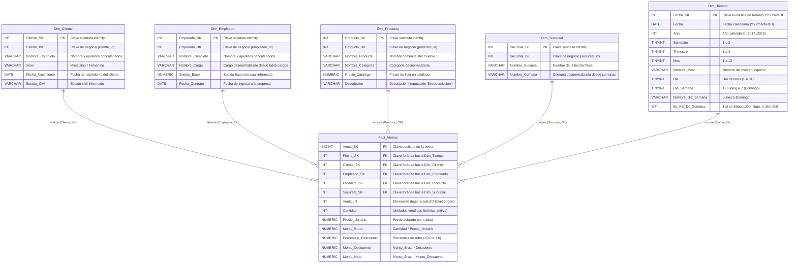

# Diagrama del Modelo Dimensional y Diccionario de Datos
## Certamen 2 - Inteligencia de Negocios (Mueblería Albarrán)

Este documento contiene la arquitectura técnica del Data Warehouse dimensional (`Albarran_DW`), diseñado bajo la metodología de Ralph Kimball (Esquema Estrella).

---

## 1. Diagrama del Esquema Estrella (Star Schema)

El siguiente diagrama modela el proceso de ventas con una tabla de hechos central (`Fact_Ventas`) conectada radialmente a 5 tablas de dimensiones:

---

## 2. Diccionario de Datos Oficial

### 2.1 Tabla de Hechos: `Fact_Ventas`
* **Descripción:** Registra las transacciones comerciales a nivel de detalle por producto vendido.
* **Granularidad:** Una fila por cada línea de producto dentro de cada venta individual.

| Columna | Tipo de Dato | Rol Kimball | Permite Nulos | Descripción y Regla de Negocio |
| :--- | :--- | :--- | :---: | :--- |
| `Venta_SK` | `BIGINT IDENTITY(1,1)` | Primary Key | No | Clave sustituta única para cada línea de venta registrada en el DW. |
| `Fecha_SK` | `INT` | Foreign Key | No | FK hacia `Dim_Tiempo` en formato numérico `YYYYMMDD`. |
| `Cliente_SK` | `INT` | Foreign Key | No | FK hacia `Dim_Cliente` obtenida mediante Lookup. Si no existe, asigna `-1`. |
| `Empleado_SK` | `INT` | Foreign Key | No | FK hacia `Dim_Empleado` obtenida mediante Lookup del vendedor. Si no existe, `-1`. |
| `Producto_SK` | `INT` | Foreign Key | No | FK hacia `Dim_Producto` obtenida mediante Lookup. Si no existe, asigna `-1`. |
| `Sucursal_SK` | `INT` | Foreign Key | No | FK hacia `Dim_Sucursal` obtenida mediante Lookup. Si no existe, asigna `-1`. |
| `Venta_ID` | `INT` | Degenerate Dimension | No | Identificador original de la boleta/factura en el sistema transaccional. |
| `Cantidad` | `INT` | Métrica Aditiva | No | Número de unidades de muebles adquiridas en la línea de venta. |
| `Precio_Unitario` | `NUMERIC(12,2)` | Métrica | No | Precio unitario cobrado al cliente al momento de la transacción. |
| `Monto_Bruto` | `NUMERIC(14,2)` | Métrica Aditiva | No | Subtotal de la venta calculado como $\text{Cantidad} \times \text{Precio\_Unitario}$. |
| `Porcentaje_Descuento` | `NUMERIC(5,4)` | Atributo Numérico | No | Porcentaje de rebaja aplicado (en el período histórico 2017 es `0.0`). |
| `Monto_Descuento` | `NUMERIC(14,2)` | Métrica Aditiva | No | Monto monetario rebajado: $\text{Monto\_Bruto} \times \text{Porcentaje\_Descuento}$. |
| `Monto_Neto` | `NUMERIC(14,2)` | Métrica Aditiva | No | Monto final facturado: $\text{Monto\_Bruto} - \text{Monto\_Descuento}$. |

---

### 2.2 Dimensión: `Dim_Cliente`
* **Descripción:** Contiene los datos sociodemográficos de los clientes que han realizado compras.

| Columna | Tipo de Dato | Rol Kimball | Permite Nulos | Descripción y Regla de Negocio |
| :--- | :--- | :--- | :---: | :--- |
| `Cliente_SK` | `INT IDENTITY(1,1)` | Primary Key | No | Clave sustituta autoincremental de la dimensión. |
| `Cliente_BK` | `INT` | Business Key | No | Clave natural en el sistema relacional (`clientes.cliente_id`). |
| `Nombre_Completo` | `VARCHAR(150)` | Atributo | No | Concatenación limpia de `nombre`, `appaterno` y `apmaterno`. |
| `Sexo` | `VARCHAR(20)` | Atributo | No | Género normalizado: `'M'` $\rightarrow$ `'Masculino'`, `'F'` $\rightarrow$ `'Femenino'`. |
| `Fecha_Nacimiento` | `DATE` | Atributo | Sí | Fecha de nacimiento para cálculo de rango etario al momento de la venta. |
| `Estado_Civil` | `VARCHAR(50)` | Atributo | Sí | Estado civil registrado en el maestro de clientes (`casado`, `soltero`). |

---

### 2.3 Dimensión: `Dim_Empleado`
* **Descripción:** Almacena la información de los colaboradores, su cargo y sueldo base.

| Columna | Tipo de Dato | Rol Kimball | Permite Nulos | Descripción y Regla de Negocio |
| :--- | :--- | :--- | :---: | :--- |
| `Empleado_SK` | `INT IDENTITY(1,1)` | Primary Key | No | Clave sustituta autoincremental de la dimensión. |
| `Empleado_BK` | `INT` | Business Key | No | Clave natural en el sistema relacional (`empleados.empleado_id`). |
| `Nombre_Completo` | `VARCHAR(150)` | Atributo | No | Concatenación limpia de `nombre`, `appaterno` y `apmaterno`. |
| `Nombre_Cargo` | `VARCHAR(100)` | Atributo | No | Cargo desnormalizado desde la tabla relacional `cargos.nombre`. |
| `Sueldo_Base` | `NUMERIC(12,2)` | Atributo Numérico | Sí | Sueldo base mensual asignado al empleado como referencia analítica. |
| `Fecha_Contrato` | `DATE` | Atributo | Sí | Fecha de ingreso y formalización del contrato laboral. |

---

### 2.4 Dimensión: `Dim_Producto`
* **Descripción:** Almacena el catálogo de muebles y sus respectivas categorías comerciales.

| Columna | Tipo de Dato | Rol Kimball | Permite Nulos | Descripción y Regla de Negocio |
| :--- | :--- | :--- | :---: | :--- |
| `Producto_SK` | `INT IDENTITY(1,1)` | Primary Key | No | Clave sustituta autoincremental de la dimensión. |
| `Producto_BK` | `INT` | Business Key | No | Clave natural en el sistema relacional (`productos.producto_id`). |
| `Nombre_Producto` | `VARCHAR(100)` | Atributo | No | Nombre comercial del mueble (ej. Comedor 6 sillas, Arrimo rústico). |
| `Nombre_Categoria` | `VARCHAR(100)` | Atributo | No | Nombre de la categoría desnormalizado desde `categorias.categoria`. |
| `Precio_Catalogo` | `NUMERIC(12,2)` | Atributo Numérico | No | Precio oficial de lista registrado en el catálogo de productos. |
| `Descripcion` | `VARCHAR(255)` | Atributo | No | Descripción del producto. Si viene `NULL`, se imputa `'Sin descripción'`. |

---

### 2.5 Dimensión: `Dim_Sucursal`
* **Descripción:** Describe las tiendas comerciales físicas de la mueblería y su ubicación geográfica.

| Columna | Tipo de Dato | Rol Kimball | Permite Nulos | Descripción y Regla de Negocio |
| :--- | :--- | :--- | :---: | :--- |
| `Sucursal_SK` | `INT IDENTITY(1,1)` | Primary Key | No | Clave sustituta autoincremental de la dimensión. |
| `Sucursal_BK` | `INT` | Business Key | No | Clave natural en el sistema relacional (`sucursales.sucursal_id`). |
| `Nombre_Sucursal` | `VARCHAR(100)` | Atributo | No | Nombre de la tienda física (ej. Manquehue, Franklin, Viña del Mar). |
| `Nombre_Comuna` | `VARCHAR(100)` | Atributo | No | Comuna desnormalizada desde la tabla relacional `comunas.comuna`. |

---

### 2.6 Dimensión: `Dim_Tiempo`
* **Descripción:** Calendario continuo multidimensional que abarca desde 2017 hasta 2026.

| Columna | Tipo de Dato | Rol Kimball | Permite Nulos | Descripción y Regla de Negocio |
| :--- | :--- | :--- | :---: | :--- |
| `Fecha_SK` | `INT` | Primary Key | No | Clave numérica fija en formato `YYYYMMDD` (ej. `20170101`). |
| `Fecha` | `DATE` | Atributo | No | Fecha calendario estándar en formato `YYYY-MM-DD`. |
| `Anio` | `INT` | Atributo | No | Año calendario en cuatro dígitos (`2017..2026`). |
| `Semestre` | `TINYINT` | Atributo | No | Semestre del año: `1` (Ene-Jun) o `2` (Jul-Dic). |
| `Trimestre` | `TINYINT` | Atributo | No | Trimestre calendario: `1`, `2`, `3` o `4`. |
| `Mes` | `TINYINT` | Atributo | No | Número del mes: `1` a `12`. |
| `Nombre_Mes` | `VARCHAR(20)` | Atributo | No | Nombre completo del mes en español (ej. `'Enero'`, `'Febrero'`). |
| `Dia` | `TINYINT` | Atributo | No | Día del mes: `1` a `31`. |
| `Dia_Semana` | `TINYINT` | Atributo | No | Día de la semana ISO: `1` (Lunes) a `7` (Domingo). |
| `Nombre_Dia_Semana` | `VARCHAR(20)` | Atributo | No | Nombre del día en español (ej. `'Lunes'`, `'Martes'`). |
| `Es_Fin_De_Semana` | `BIT` | Atributo | No | Bandera booleana: `1` para Sábado y Domingo, `0` para días hábiles. |
