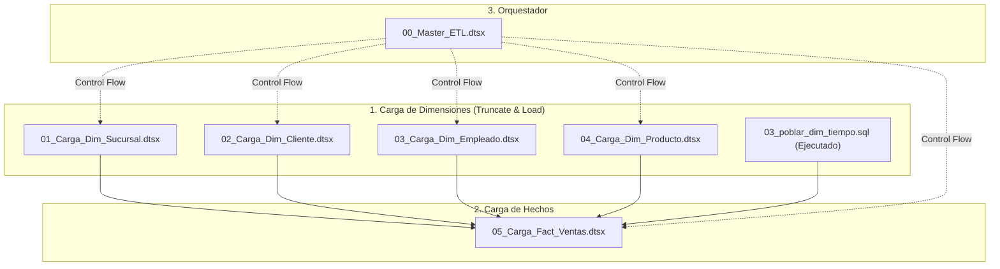

# Solución SSIS: Mueblería Albarrán (`Albarran_ETL`)
## Certamen 2 - Inteligencia de Negocios (Fase 1: ETL Dimensional)

Esta carpeta contiene la solución oficial de **SQL Server Integration Services (SSIS)** configurada en Visual Studio 2022 para la extracción, transformación y carga (ETL) desde la base transaccional (`Albarran`) hacia el Data Warehouse dimensional (`Albarran_DW`).

---

### 1. Requisitos de Software (Entorno Windows)
Para abrir, editar y ejecutar esta solución en Windows 11:
1. **Visual Studio 2022** (Community, Professional o Enterprise).
2. **Extensión:** [SQL Server Integration Services Projects 2022](https://marketplace.visualstudio.com/items?itemName=SSIS.MicrosoftDataToolsIntegrationServices) instalada vía Visual Studio Marketplace.
3. **Controlador OLE DB:** Microsoft OLE DB Driver for SQL Server (`MSOLEDBSQL` o `MSOLEDBSQL19`).
4. **Instancia SQL Server:** SQL Server 2019 / 2022 local (`localhost,1433`, `.\SQLEXPRESS` o `(local)`).

---

### 2. Estructura de la Solución
```
etl/proyecto-ssis/
├── Albarran_ETL.sln           # Solución de Visual Studio 2022
├── Albarran_ETL.dtproj        # Archivo de proyecto SSIS (TargetServerVersion: SQLServer2022)
├── Albarran_OLTP.conmgr       # Administrador de conexión OLE DB a Albarran (Origen)
├── Albarran_DW.conmgr         # Administrador de conexión OLE DB a Albarran_DW (Destino)
├── Project.params             # Parámetros del proyecto (ServerName, etc.)
└── README.md                  # Esta guía técnica de implementación
```

---

### 3. Configuración de Conexiones en Visual Studio
Al abrir `Albarran_ETL.sln`:
1. En el **Explorador de Soluciones**, expande la carpeta `Connection Managers` (Administradores de Conexión).
2. Haz doble clic en `Albarran_OLTP.conmgr`:
   - **Server name:** Selecciona o ingresa tu instancia local (ej: `localhost,1433`, `.` o `(local)`).
   - **Authentication:** `Windows Authentication` o `SQL Server Authentication` (`sa` / `StrongPassword123!`).
   - **Database name:** `Albarran`.
   - Haz clic en **Test Connection** para verificar.
3. Haz doble clic en `Albarran_DW.conmgr`:
   - Repite el procedimiento seleccionando la base de datos `Albarran_DW`.
   - Haz clic en **Test Connection**.

---

### 4. Paquetes SSIS a Desarrollar y Orden de Ejecución

Debido a la integridad referencial del esquema estrella, los paquetes **deben ejecutarse estrictamente en el siguiente orden**:



---

### 5. Especificaciones Técnicas por Paquete (Resumen STTM)

Consulta la [Matriz STTM Completa](../../docs/modelo-dimensional/matriz_mapeo_sttm.md) para ver el detalle exhaustivo.

#### 5.1 `01_Carga_Dim_Sucursal.dtsx` (Issue #10)
- **OLE DB Source:**
  ```sql
  SELECT s.sucursal_id, s.sucursal, c.comuna
  FROM dbo.sucursales s
  INNER JOIN dbo.comunas c ON s.comuna_id = c.comuna_id;
  ```
- **Derived Column:** Limpieza de espacios con `TRIM(sucursal)` y `TRIM(comuna)`.
- **OLE DB Destination:** `dbo.Dim_Sucursal` (Fast Load). Mapear `sucursal_id` $\rightarrow$ `Sucursal_BK`.

#### 5.2 `02_Carga_Dim_Cliente.dtsx` (Issue #9 - Mishas Silva)
- **OLE DB Source:** `SELECT cliente_id, nombre, appaterno, apmaterno, sexo, fecha_nacimiento, estado_civil FROM dbo.clientes;`
- **Derived Column:**
  - `Nombre_Completo`: `TRIM(nombre) + " " + TRIM(appaterno) + (ISNULL(apmaterno) ? "" : (" " + TRIM(apmaterno)))`
  - `Sexo_Texto`: `UPPER(TRIM(sexo)) == "M" ? "Masculino" : (UPPER(TRIM(sexo)) == "F" ? "Femenino" : "No Informado")`
  - `Estado_Civil_Limpio`: `ISNULL(estado_civil) ? "No Informado" : TRIM(estado_civil)`
- **OLE DB Destination:** `dbo.Dim_Cliente` (Fast Load). Mapear `cliente_id` $\rightarrow$ `Cliente_BK`.

#### 5.3 `03_Carga_Dim_Empleado.dtsx` (Issue #11)
- **OLE DB Source:**
  ```sql
  SELECT e.empleado_id, e.nombre, e.appaterno, e.apmaterno, c.nombre AS cargo, e.sueldo_base, e.fecha_contrato
  FROM dbo.empleados e
  INNER JOIN dbo.cargos c ON e.cargo_id = c.cargo_id;
  ```
- **Derived Column:**
  - `Nombre_Completo`: `TRIM(nombre) + " " + TRIM(appaterno) + (ISNULL(apmaterno) ? "" : (" " + TRIM(apmaterno)))`
  - `Cargo_Limpio`: `TRIM(cargo)`
- **OLE DB Destination:** `dbo.Dim_Empleado` (Fast Load). Mapear `empleado_id` $\rightarrow$ `Empleado_BK`.

#### 5.4 `04_Carga_Dim_Producto.dtsx` (Issue #12)
- **OLE DB Source:**
  ```sql
  SELECT p.producto_id, p.nombre, c.categoria, p.precio, p.descripcion
  FROM dbo.productos p
  INNER JOIN dbo.categorias c ON p.categoria_id = c.categoria_id;
  ```
- **Derived Column (Tratamiento Crítico de Nulos):**
  - `Descripcion_Limpia`: `ISNULL(descripcion) ? "Sin descripción" : TRIM(descripcion)`
- **OLE DB Destination:** `dbo.Dim_Producto` (Fast Load). Mapear `producto_id` $\rightarrow$ `Producto_BK`.

#### 5.5 `05_Carga_Fact_Ventas.dtsx` (Issue #13)
- **OLE DB Source:**
  ```sql
  SELECT 
      v.venta_id,
      v.fecha,
      v.cliente_id,
      v.vendedor_id,
      v.sucursal_id,
      d.producto_id,
      d.cantidad,
      d.precio_unitario,
      d.descuento
  FROM dbo.ventas v
  INNER JOIN dbo.detalle_ventas d ON v.venta_id = d.venta_id;
  ```
- **Lookup Transformations (Full Cache):**
  1. `Lookup Dim_Sucursal`: Match `sucursal_id = Sucursal_BK` $\rightarrow$ extrae `Sucursal_SK`.
  2. `Lookup Dim_Cliente`: Match `cliente_id = Cliente_BK` $\rightarrow$ extrae `Cliente_SK`.
  3. `Lookup Dim_Empleado`: Match `vendedor_id = Empleado_BK` $\rightarrow$ extrae `Empleado_SK`.
  4. `Lookup Dim_Producto`: Match `producto_id = Producto_BK` $\rightarrow$ extrae `Producto_SK`.
  *(Configurar cada Lookup para redirigir filas sin coincidencia o asignar `-1` si no existe match).*
- **Derived Column:**
  - `Fecha_SK`: `(DT_I4)(YEAR(fecha) * 10000 + MONTH(fecha) * 100 + DAY(fecha))`
  - `Monto_Bruto`: `(DT_NUMERIC, 14, 2)(cantidad * precio_unitario)`
  - `Monto_Descuento`: `(DT_NUMERIC, 14, 2)(cantidad * precio_unitario * descuento)`
  - `Monto_Neto`: `(DT_NUMERIC, 14, 2)((cantidad * precio_unitario) - (cantidad * precio_unitario * descuento))`
- **OLE DB Destination:** `dbo.Fact_Ventas` (Table or view - fast load, Keep Nulls).

---

### 6. Validación Post-Ejecución
Una vez ejecutados los paquetes, ejecuta el script de certificación en SQL Server:
```sql
-- Ejecutar en SQL Server Management Studio (SSMS)
:r ../../database/scripts/04_validacion_cuadratura_dw.sql
```
Este script audita automáticamente que existan **365 transacciones**, **724 unidades** y exactamente **$414.022.446 CLP**, sin huérfanos.
